<p align="center">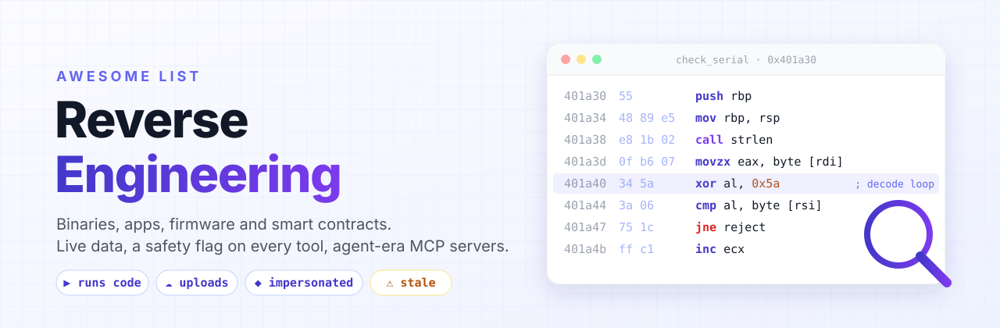</p>

# Awesome Reverse Engineering [](https://awesome.re)

> Tools and learning resources for understanding software you did not write: native binaries, Android and .NET apps, language runtimes, web apps, firmware and smart contracts. Every entry is reviewed for execution and disclosure risk, and maintenance status refreshes weekly from GitHub.

**135 entries · 19 categories · reviewed 2026-10-10 · GitHub data 2026-10-10**

## Contents

- [🧭 How to Choose](#-how-to-choose)
- [🚦 Flags](#-flags)
- [🔐 Safety First](#-safety-first)
- [⚡ Triage by Runtime](#-triage-by-runtime)
- [🔎 Identify & Triage](#-identify--triage)
- [🧾 Binary Formats & Hex Editors](#-binary-formats--hex-editors)
- [🧠 Disassemblers & Decompilers](#-disassemblers--decompilers)
- [🐞 Debuggers](#-debuggers)
- [🪝 Instrumentation & Emulation](#-instrumentation--emulation)
- [🩻 Memory & Process Analysis](#-memory--process-analysis)
- [🧮 Analysis Frameworks & Libraries](#-analysis-frameworks--libraries)
- [🔀 Binary Diffing](#-binary-diffing)
- [📱 Android & Java](#-android--java)
- [🟪 .NET](#-net)
- [🍎 iOS & macOS](#-ios--macos)
- [📦 Language Runtimes & Packagers](#-language-runtimes--packagers)
- [🌐 Web, JS & Protocols](#-web-js--protocols)
- [📟 Firmware & Embedded](#-firmware--embedded)
- [💎 Smart Contracts & EVM](#-smart-contracts--evm)
- [🦾 AI-Assisted RE & MCP Servers](#-ai-assisted-re--mcp-servers)
- [🧪 Lab & Isolation](#-lab--isolation)
- [📚 Learn](#-learn)
- [🎯 Practice Targets](#-practice-targets)
- [📅 A 12-Week Path](#-a-12-week-path)
- [💡 Craft](#-craft)
- [🧰 Recipes](#-recipes)
- [📈 About This List](#-about-this-list)
- [🔗 Related Awesome Lists](#-related-awesome-lists)

## 🧭 How to Choose

| I need to...                                                      | Start here                                                                            |
| ----------------------------------------------------------------- | ------------------------------------------------------------------------------------- |
| Learn reversing from zero                                         | [Learn](#-learn), then [Practice Targets](#-practice-targets)                         |
| Identify an unknown file and what it can do                       | [Identify & Triage](#-identify--triage)                                               |
| Read a file format or patch bytes                                 | [Binary Formats & Hex Editors](#-binary-formats--hex-editors)                         |
| Read native code                                                  | [Disassemblers & Decompilers](#-disassemblers--decompilers)                           |
| Watch a program run                                               | [Debuggers](#-debuggers), [Instrumentation & Emulation](#-instrumentation--emulation) |
| Handle Go, Flutter, Unity, React Native, Python, Electron or wasm | [Language Runtimes & Packagers](#-language-runtimes--packagers)                       |
| Look inside an APK or a .NET assembly                             | [Android & Java](#-android--java), [.NET](#-net)                                      |
| Find what changed between two versions                            | [Binary Diffing](#-binary-diffing)                                                    |
| Extract and audit device firmware                                 | [Firmware & Embedded](#-firmware--embedded)                                           |
| Check a contract or token before using it                         | [Smart Contracts & EVM](#-smart-contracts--evm)                                       |
| Let an AI agent drive the decompiler                              | [AI-Assisted RE & MCP Servers](#-ai-assisted-re--mcp-servers)                         |
| Set up a safe place to do all this                                | [Safety First](#-safety-first), [Lab & Isolation](#-lab--isolation)                   |

## 🚦 Flags

| Flag   | Meaning                                                                                                                   |
| ------ | ------------------------------------------------------------------------------------------------------------------------- |
| ▶️     | Executes or emulates target code, or loads third-party plugins and scripts. Use inside an isolated VM.                    |
| ☁️     | Sends your binary or code to a third party when used as documented (hosted service or remote model).                      |
| 🎭     | Lookalike download sites or trojanised builds have been reported. Use the linked official source only.                    |
| ⚠️     | Archived, no push in over a year, or the maintainers declare limited maintenance.                                         |
| (none) | Reviewed on 2026-10-10; none of the above known. Any parser of hostile input can have bugs, so the VM rule still applies. |

## 🔐 Safety First

The tools in this list parse hostile input, and analysts are targeted directly.

1. **Analyse in a full VM.** No network or a host-only network with no route out, no shared folders, clipboard or drag and drop, no keys, tokens or wallets, and a clean snapshot you revert after every session. WSL2 runs Linux in a lightweight VM that all your WSL distros share and that is wired into Windows (mounted drives, interop), so it is not a separate lab. Plain containers share the host kernel.
2. **Download from the official source only.** Documented cases: a trojanised cracked IDA Pro 7.5 (ESET, 2021), fake dnSpy repositories (2022), and 100+ lookalike sites for Ghidra, dnSpy and ILSpy pushing a wallet-stealing payload ([Check Point, 2026](https://research.checkpoint.com/2026/impersonation-click-hijacking-and-tds-inside-a-malware-distribution-ecosystem/)). Known fakes: `ghidralite.com`, `dnspy.org`, `dnspy.net`, `ilspy.org`.
3. **Treat project files and proof-of-concept repos as code.** Researchers were compromised by shared Visual Studio projects ([Google TAG, 2021](https://blog.google/threat-analysis-group/new-campaign-targeting-security-researchers/)), a crafted IDA database could run code until IDA 9.3sp2 ([Calif, 2026](https://calif.io/research/ida-pro)), and fake CVE PoCs pulled a malicious PyPI dependency ([ChocoPoC, 2026](https://www.yeswehack.com/news/chocopocs-vulnerability-researchers-trojanised-exploits)).
4. **Look up hashes; do not upload.** Public scanners share uploaded files with paying customers. Hash locally and search by hash.
5. **Agents read hostile text.** Strings inside a binary can carry instructions aimed at an AI analyst ([Check Point, 2025](https://research.checkpoint.com/2025/ai-evasion-prompt-injection/)). Keep approval prompts on, run MCP servers inside the VM, and verify every model claim against the disassembly.

Only analyse what you own, open-source code, CTF and crackme binaries released for analysis, or targets under written authorisation. Decompilation law varies by country; see the EU Software Directive Art. 6, US 17 USC 1201(f) and your local copyright and computer-crime laws.

## ⚡ Triage by Runtime

The language runtime decides the toolchain. Check this before opening a disassembler.

| If `file`, strings or Detect It Easy show... | It is probably      | Reach for                                                                                                    |
| -------------------------------------------- | ------------------- | ------------------------------------------------------------------------------------------------------------ |
| `Go build ID`, `runtime.gopanic`             | Go                  | [GoReSym](https://github.com/mandiant/GoReSym), then Ghidra or IDA                                           |
| `libapp.so` + `libflutter.so`                | Flutter (Dart AOT)  | [blutter](https://github.com/worawit/blutter)                                                                |
| `global-metadata.dat`, `GameAssembly`        | Unity IL2CPP        | [Il2CppDumper](https://github.com/Perfare/Il2CppDumper), [Cpp2IL](https://github.com/SamboyCoding/Cpp2IL)    |
| `index.android.bundle` with Hermes magic     | React Native Hermes | [hermes-dec](https://github.com/P1sec/hermes-dec)                                                            |
| `PYZ`, `_MEIPASS`                            | PyInstaller         | [pyinstxtractor](https://github.com/extremecoders-re/pyinstxtractor), [pycdc](https://github.com/zrax/pycdc) |
| `resources/app.asar`                         | Electron            | [@electron/asar](https://github.com/electron/asar) extract, then read JS                                     |
| magic `\0asm`                                | WebAssembly         | [WABT](https://github.com/WebAssembly/wabt)                                                                  |
| CLR header, `mscorlib`                       | .NET                | [ILSpy](https://github.com/icsharpcode/ILSpy)                                                                |
| `classes.dex`                                | Android             | [JADX](https://github.com/skylot/jadx)                                                                       |
| `.pck`, Godot strings                        | Godot               | [GDRE Tools](https://github.com/GDRETools/gdsdecomp)                                                         |
| `.js.map` next to a bundle                   | Shipped source maps | Read the original source in DevTools                                                                         |
| Rust panic strings, `core::fmt`              | Rust                | Ghidra or IDA with Rust demangling                                                                           |
| None of the above                            | Native C or C++     | [Disassemblers & Decompilers](#-disassemblers--decompilers)                                                  |

## 🔎 Identify & Triage


First fifteen minutes on any file: what is it, what built it, is it packed, what can it do.

| Tool                                                        | Last push · Stars | Cost        | Flags | Use it when                                                                                                |
| ----------------------------------------------------------- | ----------------- | ----------- | ----- | ---------------------------------------------------------------------------------------------------------- |
| [Detect It Easy](https://github.com/horsicq/Detect-It-Easy) | 2026-10 · ★ 12k   | Free        |       | Identifies compiler, linker, packer and protector for PE, ELF and Mach-O files.                            |
| [capa](https://github.com/mandiant/capa)                    | 2026-10 · ★ 6.2k  | Free        |       | Names what a binary can do (encrypt, network, persist) from rules; points you to the functions that do it. |
| [FLOSS](https://github.com/mandiant/flare-floss)            | 2026-10 · ★ 4.2k  | Free        | ▶️    | Extracts obfuscated and stack-built strings that plain `strings` misses.                                   |
| [YARA-X](https://github.com/VirusTotal/yara-x)              | 2026-10 · ★ 1.3k  | Free        |       | Rust successor to YARA for pattern-matching rules; turn findings into reusable detections.                 |
| [PE-bear](https://github.com/hasherezade/pe-bear)           | 2026-10 · ★ 3.8k  | Free        |       | Fast PE header and section viewer for first looks at Windows binaries.                                     |
| [XELFViewer](https://github.com/horsicq/XELFViewer)         | 2026-10 · ★ 1.6k  | Free        |       | ELF header, section and segment viewer.                                                                    |
| [checksec](https://github.com/slimm609/checksec)            | 2026-09 · ★ 2.4k  | Free        |       | Reports RELRO, canaries, NX, PIE and FORTIFY; now written in Go (`checksec file <bin>`).                   |
| [pestudio](https://www.winitor.com/)                        | website           | Free · Paid |       | Static Windows executable triage: imports, strings, indicators.                                            |


<p align="right">(<a href="#contents">back to top</a>)</p>

## 🧾 Binary Formats & Hex Editors


Read and describe file structures by hand or with a grammar.

| Tool                                                | Last push · Stars | Cost        | Flags | Use it when                                                                                          |
| --------------------------------------------------- | ----------------- | ----------- | ----- | ---------------------------------------------------------------------------------------------------- |
| [ImHex](https://github.com/WerWolv/ImHex)           | 2026-10 · ★ 55k   | Free        |       | Hex editor with a pattern language, data inspector and diffing for reverse engineering file formats. |
| [010 Editor](https://www.sweetscape.com/010editor/) | website           | Paid        |       | Commercial hex editor whose binary templates parse hundreds of formats.                              |
| [Kaitai Struct](https://kaitai.io/)                 | 2026-10 · ★ 4.7k  | Free        |       | Declarative format descriptions that compile to parsers in many languages, plus a web IDE.           |
| [Malcat](https://malcat.fr/)                        | website           | Free · Paid | ▶️    | Hex editor, disassembler and analyser in one for fast file triage.                                   |


<p align="right">(<a href="#contents">back to top</a>)</p>

## 🧠 Disassemblers & Decompilers

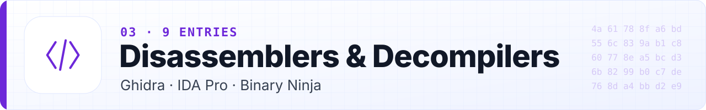

The engines everything else plugs into.

| Tool                                            | Last push · Stars | Cost             | Flags    | Use it when                                                                                                                  |
| ----------------------------------------------- | ----------------- | ---------------- | -------- | ---------------------------------------------------------------------------------------------------------------------------- |
| [Ghidra](https://ghidra-sre.org/)               | 2026-10 · ★ 82k   | Free             | 🎭 ▶️    | NSA's decompiler with scripting, BSim similarity search and a team server. Many 2026 advisories: stay on the latest release. |
| [IDA Pro](https://hex-rays.com/)                | website           | Paid · Free tier | ☁️ 🎭 ▶️ | Industry standard. Free, Home and Pro Essential decompile in the cloud; never use cracked builds.                            |
| [Binary Ninja](https://binary.ninja/)           | website           | Paid · Free tier | ▶️       | Layered intermediate languages that suit scripting; the free edition includes a local MCP server and debugger.               |
| [radare2](https://github.com/radareorg/radare2) | 2026-10 · ★ 25k   | Free             | ▶️       | Scriptable command-line framework for quick triage and automation.                                                           |
| [Rizin](https://github.com/rizinorg/rizin)      | 2026-10 · ★ 3.9k  | Free             | ▶️       | radare2 fork focused on usability and a stable API.                                                                          |
| [Cutter](https://github.com/rizinorg/cutter)    | 2026-09 · ★ 20k   | Free             | ▶️       | Rizin GUI with the Ghidra decompiler built in.                                                                               |
| [Hopper](https://www.hopperapp.com/)            | website           | Paid             | ▶️       | Affordable disassembler for macOS and Linux with strong Mach-O and Objective-C support.                                      |
| [RetDec](https://github.com/avast/retdec)       | 2026-05 · ★ 8.6k  | Free             | ⚠️       | LLVM-based retargetable decompiler. ⚠️ Limited maintenance mode, per its README.                                             |
| [Decompiler Explorer](https://dogbolt.org/)     | 2026-10 · ★ 2.7k  | Free             | ☁️       | Runs one small binary through many decompilers side by side (dogbolt.org). Uploads are kept and shared with tool authors.    |


<p align="right">(<a href="#contents">back to top</a>)</p>

## 🐞 Debuggers

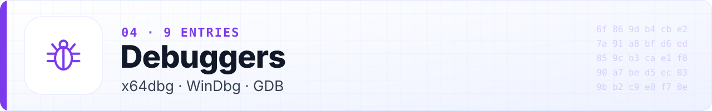

Answer one question at a time by watching the program run, inside a VM.

| Tool                                                                           | Last push · Stars | Cost | Flags | Use it when                                                                                           |
| ------------------------------------------------------------------------------ | ----------------- | ---- | ----- | ----------------------------------------------------------------------------------------------------- |
| [x64dbg](https://github.com/x64dbg/x64dbg)                                     | 2026-10 · ★ 50k   | Free | ▶️    | Open-source Windows user-mode debugger; plugins are native DLLs.                                      |
| [WinDbg](https://learn.microsoft.com/en-us/windows-hardware/drivers/debugger/) | website           | Free | ▶️    | Microsoft's debugger with Time Travel Debugging: record once, step backwards.                         |
| [GDB](https://www.sourceware.org/gdb/)                                         | website           | Free | ▶️    | The GNU debugger; the base pwndbg and GEF build on.                                                   |
| [LLDB](https://lldb.llvm.org/)                                                 | website           | Free | ▶️    | LLVM debugger, default on macOS and for Swift and Rust.                                               |
| [pwndbg](https://github.com/pwndbg/pwndbg)                                     | 2026-10 · ★ 11k   | Free | ▶️    | GDB and LLDB plugin with heap, memory and context views; keep GDB auto-load safe-path at its default. |
| [GEF](https://github.com/hugsy/gef)                                            | 2026-08 · ★ 8.4k  | Free | ▶️    | Single-file GDB enhancement, handy for remote and embedded targets.                                   |
| [rr](https://github.com/rr-debugger/rr)                                        | 2026-10 · ★ 11k   | Free | ▶️    | Record and replay for Linux: debug the same execution as many times as you need.                      |
| [Pernosco](https://pernos.co/)                                                 | website           | Paid | ☁️    | Omniscient debugging built on rr recordings; query any value at any point in time.                    |
| [edb](https://github.com/eteran/edb-debugger)                                  | 2026-10 · ★ 3k    | Free | ▶️    | x64dbg-style GUI debugger for Linux.                                                                  |


<p align="right">(<a href="#contents">back to top</a>)</p>

## 🪝 Instrumentation & Emulation

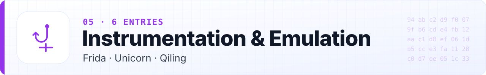

Hook, trace or emulate code without a full debugger session.

| Tool                                                 | Last push · Stars | Cost | Flags | Use it when                                                                                                              |
| ---------------------------------------------------- | ----------------- | ---- | ----- | ------------------------------------------------------------------------------------------------------------------------ |
| [Frida](https://github.com/frida/frida)              | 2026-10 · ★ 22k   | Free | ▶️    | Inject JavaScript into running processes on every major platform. frida-server listens on the device: test devices only. |
| [Unicorn](https://github.com/unicorn-engine/unicorn) | 2026-08 · ★ 9.4k  | Free | ▶️    | CPU emulator for running a snippet (a decode loop) without running the program.                                          |
| [Qiling](https://github.com/qilingframework/qiling)  | 2026-09 · ★ 6.1k  | Free | ▶️    | Whole-binary emulation with OS-level hooks; PyPI lags GitHub releases.                                                   |
| [DynamoRIO](https://github.com/DynamoRIO/dynamorio)  | 2026-10 · ★ 3.2k  | Free | ▶️    | Dynamic binary instrumentation for tracing and coverage.                                                                 |
| [QBDI](https://github.com/QBDI/QBDI)                 | 2026-09 · ★ 1.8k  | Free | ▶️    | Dynamic binary instrumentation framework for x86, x86-64, ARM and AArch64.                                               |
| [QEMU](https://www.qemu.org/)                        | 2026-10 · ★ 14k   | Free | ▶️    | Full-system and user-mode emulation; user mode forwards syscalls to the host kernel, so only inside a VM.                |


<p align="right">(<a href="#contents">back to top</a>)</p>

## 🩻 Memory & Process Analysis

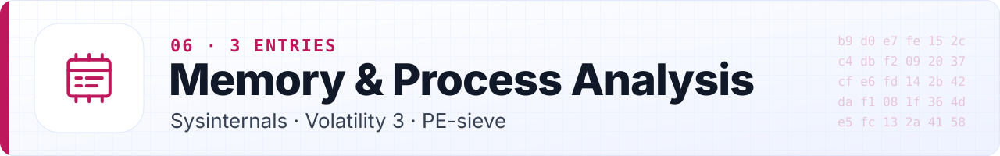

Inspect a live process or an offline memory image.

| Tool                                                                | Last push · Stars | Cost | Flags | Use it when                                                                             |
| ------------------------------------------------------------------- | ----------------- | ---- | ----- | --------------------------------------------------------------------------------------- |
| [Sysinternals](https://learn.microsoft.com/en-us/sysinternals/)     | website           | Free |       | Process Explorer, Process Monitor and friends for watching what a Windows program does. |
| [Volatility 3](https://github.com/volatilityfoundation/volatility3) | 2026-09 · ★ 4.5k  | Free |       | Offline memory image analysis: processes, modules, handles, network.                    |
| [PE-sieve](https://github.com/hasherezade/pe-sieve)                 | 2026-06 · ★ 3.9k  | Free | ▶️    | Scans a running process for implants, hooks and in-memory patches and dumps them.       |


<p align="right">(<a href="#contents">back to top</a>)</p>

## 🧮 Analysis Frameworks & Libraries


Build your own analysis: parsing, disassembly, symbolic execution.

| Tool                                                       | Last push · Stars | Cost | Flags | Use it when                                                                                        |
| ---------------------------------------------------------- | ----------------- | ---- | ----- | -------------------------------------------------------------------------------------------------- |
| [angr](https://github.com/angr/angr)                       | 2026-10 · ★ 9.1k  | Free | ▶️    | Symbolic execution and CFG recovery in Python; the standard for solving crackmes programmatically. |
| [angr management](https://github.com/angr/angr-management) | 2026-10 · ★ 1.2k  | Free | ▶️    | GUI for angr.                                                                                      |
| [Triton](https://github.com/JonathanSalwan/Triton)         | 2026-09 · ★ 4.3k  | Free | ▶️    | Dynamic symbolic execution and taint analysis library.                                             |
| [Miasm](https://github.com/cea-sec/miasm)                  | 2026-09 · ★ 4k    | Free | ▶️    | Reverse engineering framework with IR, emulation and deobfuscation helpers.                        |
| [LIEF](https://github.com/lief-project/LIEF)               | 2026-10 · ★ 5.6k  | Free |       | Parse and modify ELF, PE, Mach-O, DEX and OAT from Python, C++ or Rust.                            |
| [Capstone](https://github.com/capstone-engine/capstone)    | 2026-10 · ★ 9.1k  | Free |       | Multi-architecture disassembly library; prefer the stable 5.x line.                                |
| [Keystone](https://github.com/keystone-engine/keystone)    | 2026-07 · ★ 2.6k  | Free |       | Multi-architecture assembler library, Capstone's counterpart.                                      |


<p align="right">(<a href="#contents">back to top</a>)</p>

## 🔀 Binary Diffing

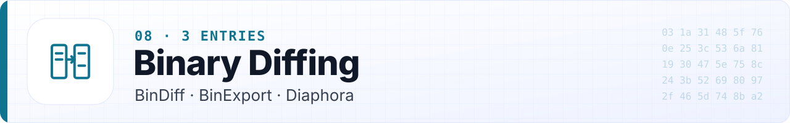

Compare two builds to find a feature or a fix fast.

| Tool                                                | Last push · Stars | Cost | Flags | Use it when                                                           |
| --------------------------------------------------- | ----------------- | ---- | ----- | --------------------------------------------------------------------- |
| [BinDiff](https://github.com/google/bindiff)        | 2026-09 · ★ 3.2k  | Free |       | Google's open-source binary diffing for IDA, Binary Ninja and Ghidra. |
| [BinExport](https://github.com/google/binexport)    | 2026-10 · ★ 1.2k  | Free |       | Exports disassembly for BinDiff from IDA, Binary Ninja and Ghidra.    |
| [Diaphora](https://github.com/joxeankoret/diaphora) | 2026-09 · ★ 4.4k  | Free |       | Advanced diffing inside IDA, including decompiler-level comparison.   |


<p align="right">(<a href="#contents">back to top</a>)</p>

## 📱 Android & Java


APK, DEX and JVM bytecode.

| Tool                                                              | Last push · Stars | Cost | Flags | Use it when                                                                             |
| ----------------------------------------------------------------- | ----------------- | ---- | ----- | --------------------------------------------------------------------------------------- |
| [JADX](https://github.com/skylot/jadx)                            | 2026-10 · ★ 51k   | Free |       | DEX to Java decompiler with GUI; static analysis of APKs.                               |
| [Apktool](https://github.com/iBotPeaches/Apktool)                 | 2026-10 · ★ 26k   | Free |       | Decode and rebuild APK resources and smali; install rebuilt APKs only on an emulator.   |
| [JEB](https://www.pnfsoftware.com/)                               | website           | Paid |       | Commercial decompiler aimed at obfuscated Android and Dalvik code.                      |
| [Bytecode Viewer](https://github.com/Konloch/bytecode-viewer)     | 2026-07 · ★ 16k   | Free |       | Java and Android bytecode viewer with several decompilers side by side.                 |
| [objection](https://github.com/sensepost/objection)               | 2026-09 · ★ 9.4k  | Free | ▶️    | Frida-powered runtime exploration for mobile apps you are authorised to test.           |
| [MobSF](https://github.com/MobSF/Mobile-Security-Framework-MobSF) | 2026-09 · ★ 22k   | Free | ▶️    | Automated static and dynamic mobile app audit; run the Docker image bound to localhost. |
| [Androguard](https://github.com/androguard/androguard)            | 2026-10 · ★ 6.3k  | Free |       | Python library for scripting APK, DEX and manifest analysis.                            |
| [Recaf](https://github.com/Col-E/Recaf)                           | 2026-09 · ★ 7.4k  | Free |       | Modern Java bytecode editor and decompiler front end.                                   |


<p align="right">(<a href="#contents">back to top</a>)</p>

## 🟪 .NET

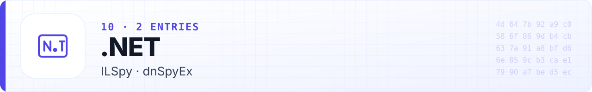

Managed code decompiles close to source.

| Tool                                          | Last push · Stars | Cost | Flags | Use it when                                                                                                       |
| --------------------------------------------- | ----------------- | ---- | ----- | ----------------------------------------------------------------------------------------------------------------- |
| [ILSpy](https://github.com/icsharpcode/ILSpy) | 2026-10 · ★ 26k   | Free | 🎭    | Static .NET decompiler for reading managed code without running it. ilspy.org is not official.                    |
| [dnSpyEx](https://github.com/dnSpyEx/dnSpy)   | 2026-08 · ★ 11k   | Free | ▶️ 🎭 | Maintained dnSpy continuation with a debugger. dnspy.org and dnspy.net have served malware: GitHub releases only. |


<p align="right">(<a href="#contents">back to top</a>)</p>

## 🍎 iOS & macOS


Mach-O, IPSW and Apple firmware.

| Tool                                     | Last push · Stars | Cost | Flags | Use it when                                                                           |
| ---------------------------------------- | ----------------- | ---- | ----- | ------------------------------------------------------------------------------------- |
| [ipsw](https://github.com/blacktop/ipsw) | 2026-10 · ★ 3.8k  | Free |       | Swiss-army tool for IPSW, kernelcache, dyld_shared_cache and Mach-O analysis.         |
| [Corellium](https://www.corellium.com/)  | website           | Paid | ☁️    | Virtual Arm iOS and Android devices for research; owned by Cellebrite since Dec 2025. |


<p align="right">(<a href="#contents">back to top</a>)</p>

## 📦 Language Runtimes & Packagers

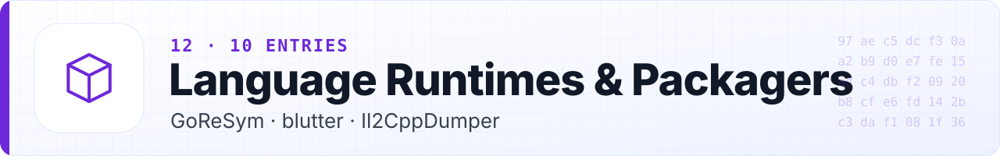

The runtime decides the tool. Check this table before opening a disassembler.

| Tool                                                                 | Last push · Stars | Cost | Flags | Use it when                                                                                            |
| -------------------------------------------------------------------- | ----------------- | ---- | ----- | ------------------------------------------------------------------------------------------------------ |
| [GoReSym](https://github.com/mandiant/GoReSym)                       | 2026-09 · ★ 1.1k  | Free |       | Go: recovers function names, types and build info from stripped binaries.                              |
| [blutter](https://github.com/worawit/blutter)                        | 2026-08 · ★ 2.7k  | Free |       | Flutter: analyses Dart AOT snapshots in libapp.so.                                                     |
| [Il2CppDumper](https://github.com/Perfare/Il2CppDumper)              | 2024-08 · ★ 9.5k  | Free | ⚠️    | Unity IL2CPP: restores class and method metadata.                                                      |
| [hermes-dec](https://github.com/P1sec/hermes-dec)                    | 2026-08 · ★ 1.2k  | Free |       | React Native Hermes bytecode disassembler and decompiler.                                              |
| [pyinstxtractor](https://github.com/extremecoders-re/pyinstxtractor) | 2026-07 · ★ 4.5k  | Free |       | PyInstaller: extracts the bundled .pyc files.                                                          |
| [pycdc](https://github.com/zrax/pycdc)                               | 2026-04 · ★ 4.6k  | Free |       | Python bytecode decompiler.                                                                            |
| [GDRE Tools](https://github.com/GDRETools/gdsdecomp)                 | 2026-10 · ★ 4.3k  | Free |       | Godot: recovers projects and decompiles GDScript.                                                      |
| [@electron/asar](https://github.com/electron/asar)                   | 2026-10 · ★ 2.9k  | Free |       | Electron: extract app.asar to read the app's JavaScript; pin the version.                              |
| [WABT](https://github.com/WebAssembly/wabt)                          | 2026-10 · ★ 8.1k  | Free |       | WebAssembly: wasm2wat, wasm-objdump and wasm-decompile to C-like pseudocode.                           |
| [Cpp2IL](https://github.com/SamboyCoding/Cpp2IL)                     | 2026-09 · ★ 2.9k  | Free |       | Unity IL2CPP to IL recovery; work in progress, check supported Unity versions, use on your own builds. |


<p align="right">(<a href="#contents">back to top</a>)</p>

## 🌐 Web, JS & Protocols


Bundles, source maps, traffic and undocumented APIs of services you use.

| Tool                                                              | Last push · Stars | Cost        | Flags | Use it when                                                                                            |
| ----------------------------------------------------------------- | ----------------- | ----------- | ----- | ------------------------------------------------------------------------------------------------------ |
| [webcrack](https://github.com/j4k0xb/webcrack)                    | 2026-07 · ★ 3k    | Free        | ▶️    | Deobfuscates obfuscator.io output and unpacks webpack and browserify bundles.                          |
| [mitmproxy](https://github.com/mitmproxy/mitmproxy)               | 2026-10 · ★ 45k   | Free        |       | Intercepting HTTPS proxy for your own apps' traffic; keep its CA on test devices only.                 |
| [mitmproxy2swagger](https://github.com/alufers/mitmproxy2swagger) | 2026-10 · ★ 9.6k  | Free        |       | Turns captures into an OpenAPI spec; sanitize tokens first.                                            |
| [Wireshark](https://www.wireshark.org/)                           | website           | Free        |       | Packet analysis; never run the GUI as root.                                                            |
| [Chrome DevTools](https://developer.chrome.com/docs/devtools/)    | website           | Free        |       | Sources with source maps, network panel and HAR export; use a separate browser profile with no wallet. |
| [Burp Suite](https://portswigger.net/burp)                        | website           | Free · Paid |       | Intercepting proxy for testing web apps you are authorised to test.                                    |
| [HTTP Toolkit](https://httptoolkit.com/)                          | 2026-10 · ★ 736   | Free · Paid |       | One-click interception for browsers, Android, Node and Docker.                                         |


<p align="right">(<a href="#contents">back to top</a>)</p>

## 📟 Firmware & Embedded

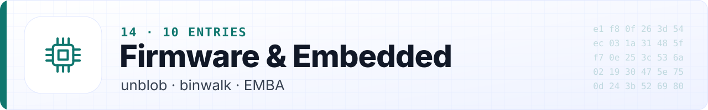

Extraction, emulation and audit of device images you own.

| Tool                                                             | Last push · Stars | Cost        | Flags | Use it when                                                                                              |
| ---------------------------------------------------------------- | ----------------- | ----------- | ----- | -------------------------------------------------------------------------------------------------------- |
| [unblob](https://github.com/onekey-sec/unblob)                   | 2026-10 · ★ 2.6k  | Free        |       | Recursive extraction of 78+ formats; runs as a normal user with traversal guards and a Landlock sandbox. |
| [binwalk](https://github.com/ReFirmLabs/binwalk)                 | 2026-08 · ★ 14k   | Free        |       | Signature scanning and entropy analysis (v3 is a Rust rewrite); never extract as root.                   |
| [EMBA](https://github.com/e-m-b-a/emba)                          | 2026-10 · ★ 3.7k  | Free        | ▶️    | Full firmware audit with emulation, SBOM and CVE report; uses sudo, dedicated VM only.                   |
| [FACT](https://github.com/fkie-cad/FACT_core)                    | 2026-10 · ★ 1.5k  | Free        |       | Fraunhofer's firmware analysis and comparison platform.                                                  |
| [FirmAE](https://github.com/pr0v3rbs/FirmAE)                     | 2026-06 · ★ 945   | Free        | ▶️    | Emulates router and IoT firmware for dynamic analysis.                                                   |
| [dji-firmware-tools](https://github.com/o-gs/dji-firmware-tools) | 2026-07 · ★ 2.2k  | Free        |       | Parses DJI firmware packages; do not flash modified images to aircraft you fly.                          |
| [UEFITool](https://github.com/LongSoft/UEFITool)                 | 2026-07 · ★ 5.7k  | Free        |       | Parses and extracts UEFI firmware images.                                                                |
| [OFRAK](https://github.com/redballoonsecurity/ofrak)             | 2026-08 · ★ 2.1k  | Free · Paid |       | Unpack, analyse, modify and repack firmware in one framework.                                            |
| [OpenOCD](https://openocd.org/)                                  | 2026-10 · ★ 2.3k  | Free        | ▶️    | On-chip debugging over JTAG and SWD for hardware you own.                                                |
| [sigrok](https://sigrok.org/)                                    | website           | Free        |       | Logic analyser software and protocol decoders for UART, SPI, I2C and more.                               |


<p align="right">(<a href="#contents">back to top</a>)</p>

## 💎 Smart Contracts & EVM

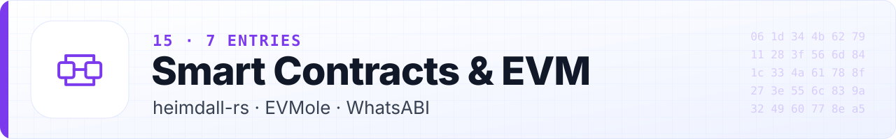

Read unverified bytecode before you interact with it. Read-only, no wallet needed.

| Tool                                                     | Last push · Stars | Cost             | Flags | Use it when                                                                                                                    |
| -------------------------------------------------------- | ----------------- | ---------------- | ----- | ------------------------------------------------------------------------------------------------------------------------------ |
| [heimdall-rs](https://github.com/Jon-Becker/heimdall-rs) | 2026-10 · ★ 1.6k  | Free             |       | Decompile, disassemble and decode unverified contracts. Use release binaries; the default installer is curl to bash over HTTP. |
| [EVMole](https://github.com/cdump/evmole)                | 2026-09 · ★ 467   | Free             |       | Selectors, arguments, mutability and storage layout from bytecode; has an MCP server (pin its version).                        |
| [WhatsABI](https://github.com/shazow/whatsabi)           | 2026-09 · ★ 1.2k  | Free             |       | Recovers ABIs and follows proxies to implementations.                                                                          |
| [Panoramix](https://github.com/palkeo/panoramix)         | 2024-08 · ★ 954   | Free             | ⚠️    | Python EVM decompiler; a second opinion.                                                                                       |
| [Dedaub](https://dedaub.com/)                            | website           | Free tier · Paid | ☁️    | Hosted decompiler with Solidity-like output; keep unreleased contracts out.                                                    |
| [Foundry cast](https://github.com/foundry-rs/foundry)    | 2026-10 · ★ 11k   | Free             |       | `cast code`, `cast storage` on ERC-1967 slots and `cast 4byte` for read-only checks.                                           |
| [evm.codes](https://www.evm.codes/)                      | website           | Free             |       | Interactive opcode reference and playground.                                                                                   |


<p align="right">(<a href="#contents">back to top</a>)</p>

## 🦾 AI-Assisted RE & MCP Servers

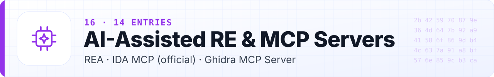

Agents and plugins driving the engines above, grouped by engine. Treat every model claim as a hypothesis, keep approvals on, and run servers inside the lab VM.

| Tool                                                                | Last push · Stars | Cost             | Flags | Use it when                                                                                                                                                             |
| ------------------------------------------------------------------- | ----------------- | ---------------- | ----- | ----------------------------------------------------------------------------------------------------------------------------------------------------------------------- |
| [REA](https://github.com/morluto/rea)                               | 2026-10 · ★ 49k   | Free             | ▶️    | One MCP server over twelve target types (Ghidra, IDA, Hopper, JADX, Binwalk, browser, processes). Runtime capture runs targets as you with no sandbox; pin the version. |
| [IDA MCP (official)](https://github.com/HexRaysSA/ida-mcp)          | 2026-10 · ★ 896   | Needs IDA Pro    |       | Hex-Rays' own server over stdio or Streamable HTTP; needs IDA 9.4+ with idalib and Python 3.11+.                                                                        |
| [IDA Pro MCP](https://github.com/mrexodia/ida-pro-mcp)              | 2026-09 · ★ 13k   | Needs IDA Pro    | ▶️    | Popular community server; py_eval, patch and debugger tools are high impact, leave them off.                                                                            |
| [ida-mcp-rs](https://github.com/blacktop/ida-mcp-rs)                | 2026-10 · ★ 857   | Needs IDA Pro    |       | Headless IDA MCP server in Rust.                                                                                                                                        |
| [Ghidra MCP Server](https://github.com/bethington/ghidra-mcp)       | 2026-10 · ★ 5.2k  | Free             | ▶️    | Actively maintained Ghidra server with 200+ tools including debugging.                                                                                                  |
| [GhidraMCP](https://github.com/LaurieWired/GhidraMCP)               | 2025-06 · ★ 11k   | Free             | ⚠️    | The original Ghidra MCP bridge; unauthenticated localhost HTTP.                                                                                                         |
| [ReVa](https://github.com/cyberkaida/reverse-engineering-assistant) | 2026-10 · ★ 859   | Free             | ▶️    | Ghidra MCP server with small, context-efficient tools; PyGhidra scripting is on by default.                                                                             |
| [Binary Ninja MCP](https://docs.binary.ninja/guide/mcp.html)        | website           | Free tier · Paid |       | Built into Binary Ninja; the GUI server works in every edition, headless needs Commercial or Ultimate.                                                                  |
| [JADX AI MCP](https://github.com/zinja-coder/jadx-ai-mcp)           | 2026-09 · ★ 2.9k  | Free             |       | JADX plugin exposing Android analysis to MCP clients.                                                                                                                   |
| [radare2 MCP](https://github.com/radareorg/radare2-mcp)             | 2026-10 · ★ 318   | Free             |       | stdio MCP server for radare2.                                                                                                                                           |
| [r2ai](https://github.com/radareorg/r2ai)                           | 2026-10 · ★ 486   | Free             | ☁️    | LLM-assisted decompilation (decai) and agent mode inside radare2.                                                                                                       |
| [Gepetto](https://github.com/JusticeRage/Gepetto)                   | 2026-08 · ★ 3.5k  | Free             | ☁️    | IDA plugin that explains functions and renames variables; sends code to the chosen provider unless you configure a local model.                                         |
| [GhidrAssist](https://github.com/symgraph/GhidrAssist)              | 2026-09 · ★ 753   | Free             | ☁️    | LLM chat, RAG and agent mode inside Ghidra; hosted or local models.                                                                                                     |
| [LLM4Decompile](https://github.com/albertan017/LLM4Decompile)       | 2026-02 · ★ 7.1k  | Free             |       | Open decompilation models that run locally; 27 to 65% of functions re-execute correctly on its benchmark.                                                               |

**MCP servers at a glance** (from each project's README, 2026-10-10)

| Server             | Engine                                                 | Transport                                                   | High-impact capabilities                                                  |
| ------------------ | ------------------------------------------------------ | ----------------------------------------------------------- | ------------------------------------------------------------------------- |
| REA                | Ghidra, IDA, Hopper, JADX, Binwalk, browser, processes | Local MCP                                                   | Runtime capture runs targets with your permissions; no sandbox documented |
| IDA MCP (official) | IDA 9.4+ with idalib                                   | stdio or Streamable HTTP                                    | Agent-written idalib scripts ("code mode")                                |
| IDA Pro MCP        | IDA Pro 8.3+                                           | stdio or loopback HTTP/SSE                                  | `py_eval`, patching, debugger tools (opt-in)                              |
| GhidraMCP          | Ghidra                                                 | Unauthenticated HTTP on localhost:8080, stdio or SSE bridge | Renaming                                                                  |
| ReVa               | Ghidra 12.0+                                           | Streamable HTTP on 8080, optional API key                   | PyGhidra scripting on by default                                          |
| Binary Ninja MCP   | Binary Ninja                                           | Built in                                                    | Headless use needs Commercial or Ultimate                                 |
| radare2 MCP        | radare2                                                | stdio                                                       | radare2 commands                                                          |

<p align="right">(<a href="#contents">back to top</a>)</p>

## 🧪 Lab & Isolation


Where all of the above should run.

| Tool                                                                                                                                     | Last push · Stars | Cost | Flags | Use it when                                                                                  |
| ---------------------------------------------------------------------------------------------------------------------------------------- | ----------------- | ---- | ----- | -------------------------------------------------------------------------------------------- |
| [FLARE-VM](https://github.com/mandiant/flare-vm)                                                                                         | 2026-10 · ★ 9.1k  | Free |       | Windows analysis VM build scripts; install only in a VM and switch to host-only after setup. |
| [REMnux](https://remnux.org/)                                                                                                            | website           | Free |       | Ubuntu-based analysis distro and appliance; check the published SHA-256.                     |
| [VMware Workstation Pro](https://blogs.vmware.com/cloud-foundation/2024/11/11/vmware-fusion-and-workstation-are-now-free-for-all-users/) | website           | Free |       | Free for all users since Nov 2024; patch it and the guest tools.                             |


<p align="right">(<a href="#contents">back to top</a>)</p>

## 📚 Learn


Courses, books and references, in roughly the order to use them.

| Tool                                                                                  | Last push · Stars | Cost               | Flags | Use it when                                                                                                                      |
| ------------------------------------------------------------------------------------- | ----------------- | ------------------ | ----- | -------------------------------------------------------------------------------------------------------------------------------- |
| [Compiler Explorer](https://godbolt.org/)                                             | 2026-10 · ★ 19k   | Free               | ☁️    | See C and C++ become assembly across compilers and -O levels; the hosted site keeps shared links, so self-host for private code. |
| [pwn.college](https://pwn.college/)                                                   | website           | Free               |       | ASU's hands-on dojos from Computing 101 to a full reversing course.                                                              |
| [OpenSecurityTraining2](https://p.ost2.fyi/)                                          | website           | Free               |       | Arch1001 x86-64, Dbg1012 GDB, Dbg1102 Ghidra, RE3011 C++ binaries.                                                               |
| [Dive Into Systems](https://diveintosystems.org/)                                     | website           | Free               |       | C, gdb, optimisation and assembly for x86-64 and ARM64 in one free book.                                                         |
| [Azeria Labs](https://azeria-labs.com/writing-arm-assembly-part-1/)                   | website           | Free               |       | ARM assembly tutorials; 32-bit ARM only, pair with an AArch64 text.                                                              |
| [Reverse-Engineering tutorial](https://github.com/mytechnotalent/Reverse-Engineering) | 2026-10 · ★ 14k   | Free               |       | Free tutorial covering x86, x64, ARM and AVR with worked examples.                                                               |
| [Nightmare](https://github.com/guyinatuxedo/nightmare)                                | 2026-02 · ★ 3.2k  | Free               |       | Course built from annotated past CTF binaries using Ghidra, GEF and angr.                                                        |
| [OWASP MASTG](https://mas.owasp.org/MASTG/)                                           | 2026-10 · ★ 13k   | Free               |       | The mobile app security testing guide, including Android and iOS reverse engineering.                                            |
| [Practical Binary Analysis](https://nostarch.com/binaryanalysis)                      | website           | Paid               |       | Formats, disassembly, instrumentation, taint and symbolic execution; concepts current, bundled VM dated (2018).                  |
| [The Ghidra Book, 2nd ed](https://nostarch.com/node/831)                              | website           | Paid               |       | March 2026 edition with BSim, PyGhidra and the debugger.                                                                         |
| [The Art of ARM Assembly, Vol 1](https://nostarch.com/art-arm-assembly-volume-1)      | website           | Paid               |       | Deep 64-bit ARM programming text (2025).                                                                                         |
| [Reverse Engineering for Beginners](https://beginners.re/)                            | website           | About $1 (Patreon) |       | Large catalogue of compiled C patterns; leans on 32-bit x86 and older compilers.                                                 |
| [RPISEC MBE](https://github.com/RPISEC/MBE)                                           | 2021-12 · ★ 6.1k  | Free               | ⚠️    | Modern Binary Exploitation course; labs need older toolchains.                                                                   |
| [Reverse Engineering Stack Exchange](https://reverseengineering.stackexchange.com/)   | website           | Free               |       | Q&A for specific technical questions.                                                                                            |


<p align="right">(<a href="#contents">back to top</a>)</p>

## 🎯 Practice Targets


Legal targets, ordered from browser-only exercises to downloaded binaries that need a Windows VM.

| Tool                                                                        | Last push · Stars | Cost           | Flags | Use it when                                                                                                               |
| --------------------------------------------------------------------------- | ----------------- | -------------- | ----- | ------------------------------------------------------------------------------------------------------------------------- |
| [picoGym](https://picoctf.org/)                                             | website           | Free           |       | CMU's year-round challenges with a gentle reversing category; many run in the browser, some need a download (use the VM). |
| [Microcorruption](https://microcorruption.com/)                             | website           | Free           |       | MSP430 lock puzzles in a browser emulator.                                                                                |
| [OverTheWire](https://overthewire.org/wargames/)                            | website           | Free           |       | Bandit, then Leviathan for reversing, over SSH.                                                                           |
| [crackmes.one](https://crackmes.one/)                                       | website           | Free           | ▶️    | Large reviewed crackme library with no-malware rules; VM only.                                                            |
| [challenges.re](https://challenges.re/)                                     | website           | Free           |       | Short multi-architecture exercises; no public write-ups.                                                                  |
| [Root-Me Cracking](https://www.root-me.org/en/Challenges/Cracking)          | website           | Free · Premium | ▶️    | About 70 challenges across ELF, PE, .NET, APK, wasm and game engines.                                                     |
| [Ethernaut](https://github.com/OpenZeppelin/ethernaut)                      | 2026-10 · ★ 2.3k  | Free           |       | EVM wargame including storage and bytecode levels; testnet-only key.                                                      |
| [Damn Vulnerable DeFi](https://github.com/theredguild/damn-vulnerable-defi) | 2025-03 · ★ 1.4k  | Free           | ⚠️    | 18 local DeFi challenges on Foundry; run locally.                                                                         |
| [Flare-On](https://flare-on.com/)                                           | website           | Free           | ▶️    | Annual Windows reversing contest with official solutions back to 2014; Windows VM.                                        |


<p align="right">(<a href="#contents">back to top</a>)</p>

## 📅 A 12-Week Path

| Weeks | Goal                        | Do                                                                                                                                                                       |
| ----- | --------------------------- | ------------------------------------------------------------------------------------------------------------------------------------------------------------------------ |
| 1-2   | Lab built; C to assembly    | Build an isolated VM. Compile your own small C programs at -O0 and -O2 and read them in [Compiler Explorer](https://godbolt.org/) and Ghidra. pwn.college Computing 101. |
| 3-4   | x86-64, the ABI, ELF and PE | OST2 Arch1001 and Dbg1102. The SysV and Microsoft x64 calling conventions. *Practical Binary Analysis* chapters 2-3.                                                     |
| 5-6   | First challenges            | OverTheWire Leviathan, picoGym reversing, Microcorruption, then crackmes.one level 1 in the VM.                                                                          |
| 7-8   | A domain you care about     | EVM bytecode with heimdall and EVMole, Android with JADX, or firmware with unblob.                                                                                       |
| 9-10  | Audit your own software     | Unpack your own APK, Electron app or firmware the way an outsider would, then fix what leaks.                                                                            |
| 11-12 | AI-assisted, verified       | Re-solve earlier challenges with an MCP server inside the VM and check every claim against disassembly and a debugger run.                                               |

## 💡 Craft

**Rookie mistakes:** treating decompiler output as truth; reading from `main` line by line; hand-reversing statically linked libraries (label them with Function ID, FLIRT or BSim); default names everywhere; no notes; missing the easy way in (source maps, symbols, plain JS in an asar); wrong firmware load address; running targets on the host; believing AI summaries unchecked.

**Pro moves:** fifteen minutes of triage by runtime; start from an anchor (string, import, constant) and walk cross-references backwards; use the debugger to answer one question; diff two builds; fix types and structs first; identify crypto by constants with capa; compile your own code to learn compiler idioms; script early; capture traffic first; recompile your reconstruction and test it against the original.

## 🧰 Recipes

**Look up a file by hash without uploading it**
```bash
hash=$(sha256sum sample.bin | cut -d' ' -f1)
curl -s -H "x-apikey: $VT_API_KEY" "https://www.virustotal.com/api/v3/files/$hash"
```

**Partially redact a HAR before sharing it**
```bash
jq '(.log.entries[] | .request.headers, .response.headers) |= map(select(.name | test("^(cookie|set-cookie|authorization|proxy-authorization|x-api-key|x-auth-token)$"; "i") | not)) | (.log.entries[] | .request.cookies, .response.cookies) |= []' in.har > redacted.har
```
This removes cookies and common auth headers only. URLs, query strings and request and response bodies can still hold tokens and personal data: search `redacted.har` for them before sharing, or share only the entries you need.

**Find a proxy's implementation from raw storage (ERC-1967, read-only)**
```bash
cast storage "$ADDR" 0x360894a13ba1a3210667c828492db98dca3e2076cc3735a920a3ca505d382bbc --rpc-url "$RPC"
```

**Build your own first targets**
```bash
gcc -O0 -g -o prog-O0 prog.c && gcc -O2 -o prog-O2 prog.c && strip prog-O2
```
Reverse the stripped -O2 build, then check your answer against the source.

## 📈 About This List

- **Maintenance data.** Last push, stars and archive status refresh weekly from the GitHub API. A refresh that fails for more than a fifth of repositories fails CI and keeps the previous data, so the date shown is the last successful refresh.
- **Editorial review.** Flags, costs and descriptions were last reviewed on 2026-10-10. 51 entries carry a safety flag; 6 carry a maintenance warning. Changes are logged in [CHANGELOG.md](CHANGELOG.md).
- **Graveyard.** Archived and replaced tools live in [GRAVEYARD.md](GRAVEYARD.md).
- **Machine-readable.** [`data.json`](data.json) is the source; [`llms.txt`](llms.txt) and [`report.json`](report.json) carry the same entries with flags and maintenance state.

<p align="center">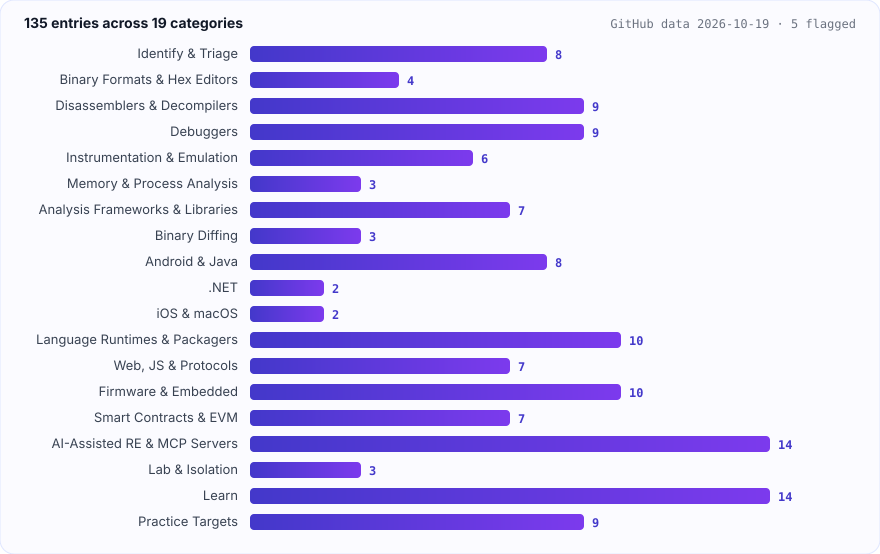</p>

## 🔗 Related Awesome Lists

| List                                                                                               | Description                                       |
| -------------------------------------------------------------------------------------------------- | ------------------------------------------------- |
| [awesome-malware-analysis](https://github.com/rshipp/awesome-malware-analysis)                     | Malware analysis tools and resources.             |
| [awesome-mobile-security](https://github.com/vaib25vicky/awesome-mobile-security)                  | Android and iOS security testing.                 |
| [awesome-embedded-and-iot-security](https://github.com/fkie-cad/awesome-embedded-and-iot-security) | Embedded and IoT security research.               |
| [OWASP MASTG](https://github.com/OWASP/mastg)                                                      | The mobile app security testing guide.            |
| [awesome-OSINT](https://github.com/edwardtay/awesome-OSINT)                                        | Open-source intelligence, including threat intel. |

## Contributing

Contributions welcome. Read [CONTRIBUTING.md](CONTRIBUTING.md) first. Add entries to [`data.json`](data.json), not the README; `node scripts/build.mjs --offline` regenerates it and `--check` validates it (CI runs the check on every PR).

- One sentence per entry, ending with a period, saying when the tool is the right choice.
- Link the official repository or site, never a mirror.
- Set the safety flags honestly: `runs`, `cloud`, `impersonated`.
- No tools whose main purpose is cracking licences, bypassing DRM or cheating in online games.

Listed projects keep their own licences. This list is released under [CC0 1.0](LICENSE).
